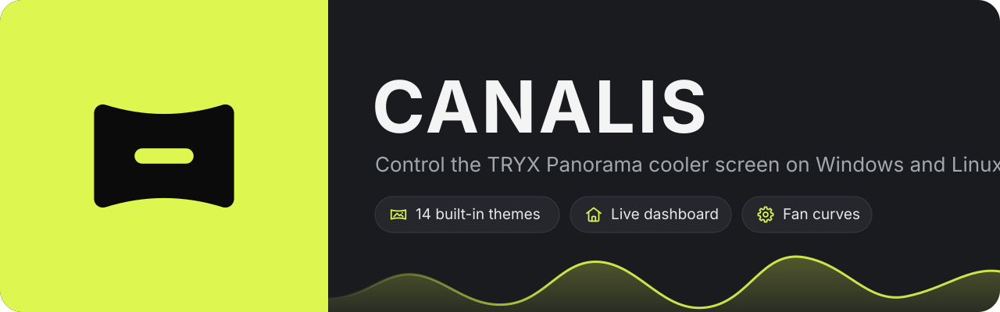
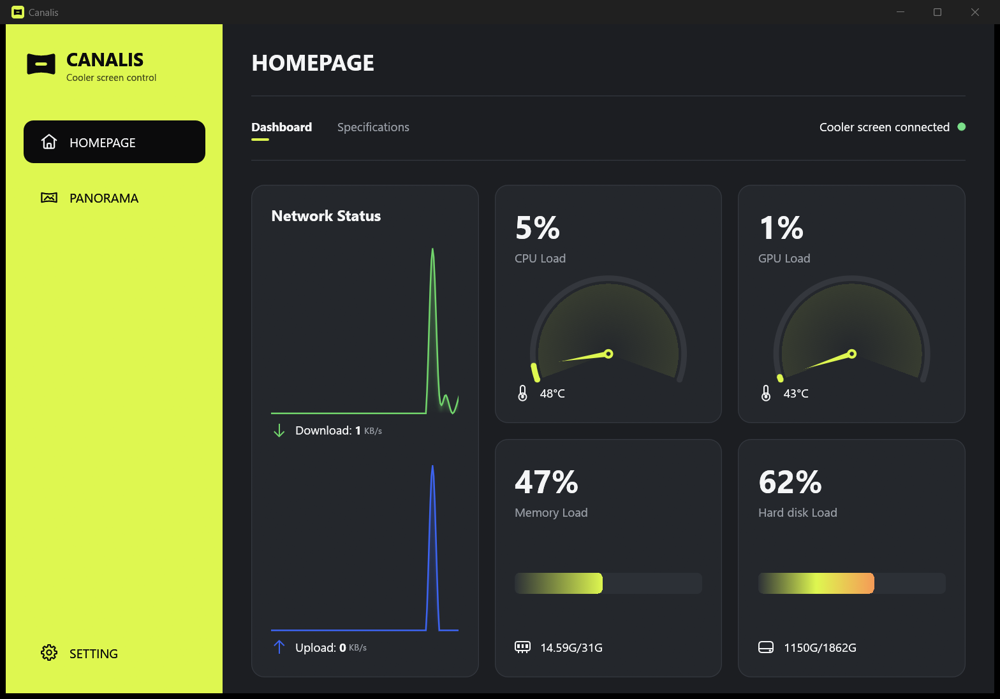
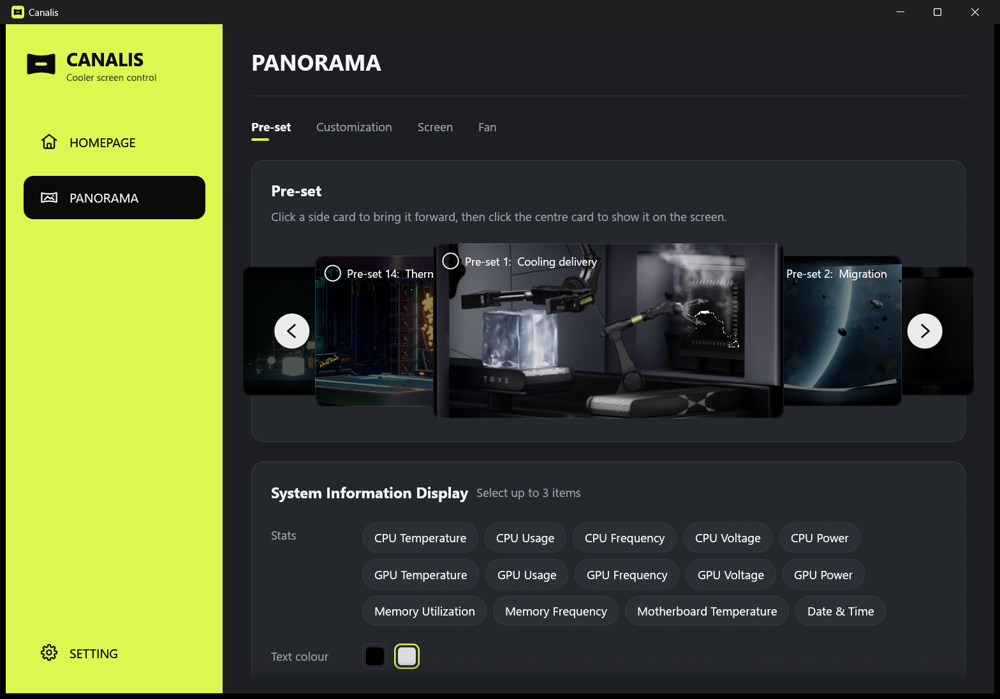
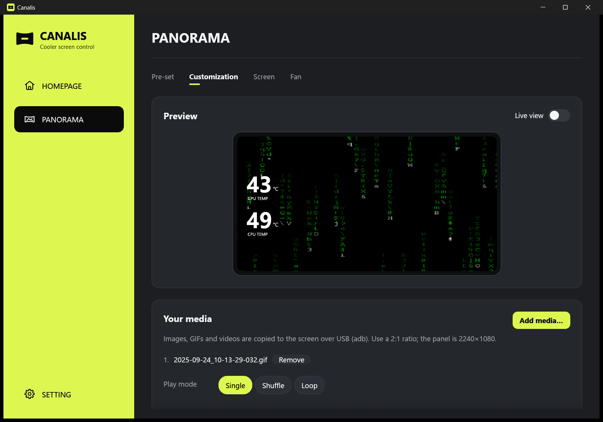
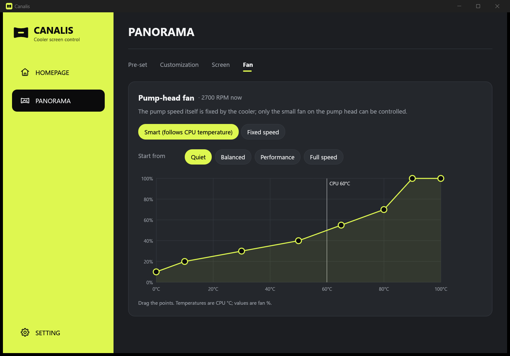

<p align="center"></p>

A lightweight replacement for TRYX **KANALI** that controls the **TRYX Panorama** cooler screen on Windows and Linux.

## Screenshots

| Dashboard | Built-in themes |
| --- | --- |
|  |  |
| **Your own media** | **Fan** |
|  |  |

## Install

Download the latest build from [Releases](https://github.com/sallen2/canalis/releases/latest).

**Windows:** run `canalis-setup-….exe`.

**Linux (Arch / Omarchy):** extract `canalis-…-linux-x64.tar.gz` and run:

```bash
./install.sh
```

The installer sets up everything Canalis needs, turns off KANALI's start at login, and starts Canalis when you log in. Uninstall it from Windows' **Installed apps**, or with `uninstall.sh` on Linux; your settings are kept.

## Use

Open **Canalis** from the Start menu or app launcher. A background service keeps the screen updated with live stats, even when the window is closed; its tray icon reopens the window.

Settings can also be changed from a terminal:

```bash
canalis preset 12        # built-in theme 1-14
canalis brightness 70
canalis fan fixed 60     # or: canalis fan smart
canalis show             # print all settings
```

Run `canalis --help` for the rest.

## Build from source

```bash
cargo test
cargo run --release
```

The install scripts build Canalis themselves when run from a copy of this repository. [How it works](docs/how-it-works.md) covers the screen's protocol, what was learned from KANALI, and known gaps.

## Privacy

This program will not transfer any information to other networked systems unless specifically requested by the user or the person installing or operating it. Canalis talks only to the cooler over USB and, on Windows, to LibreHardwareMonitor on `127.0.0.1`. The installers download adb, ffmpeg and LibreHardwareMonitor from their publishers through winget (Windows) or pacman (Linux).

## Code signing policy

Free code signing provided by [SignPath.io](https://about.signpath.io), certificate by [SignPath Foundation](https://signpath.org). (Applied for; v0.4.0 is not signed yet.)

Only Windows releases built by this repository's [release workflow](.github/workflows/release.yml) from a version tag are signed, and every signing request is approved by hand.

- Committers and reviewers: [@sallen2](https://github.com/sallen2)
- Approvers: [@sallen2](https://github.com/sallen2)

## License

[MIT](LICENSE)
